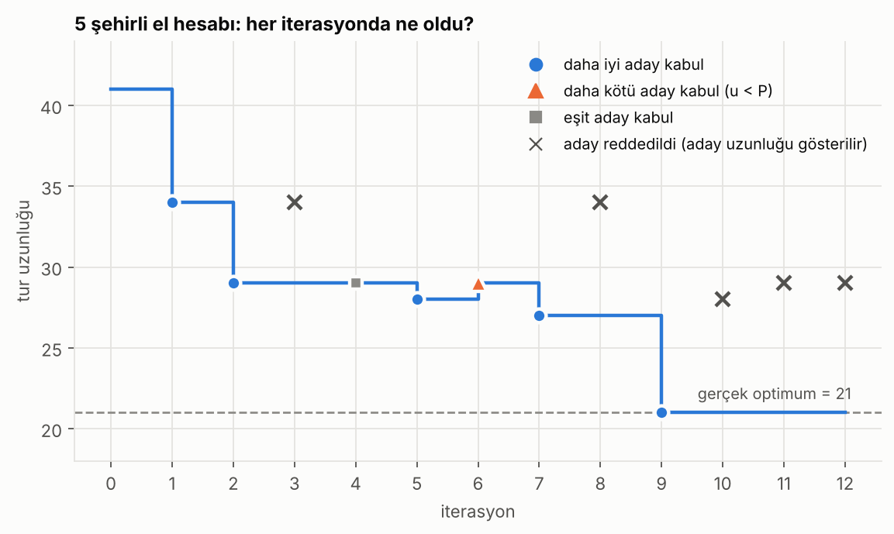
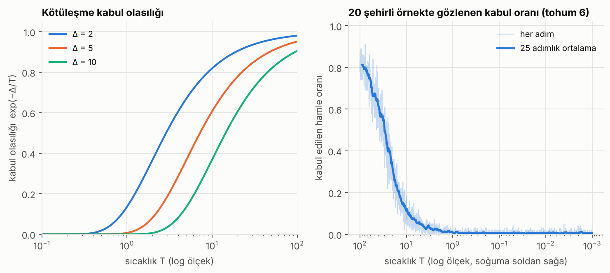
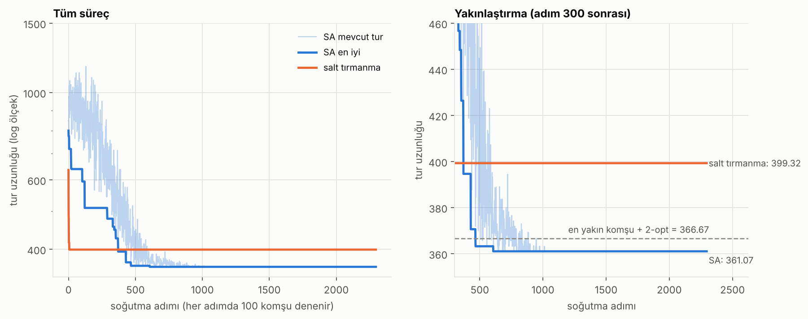
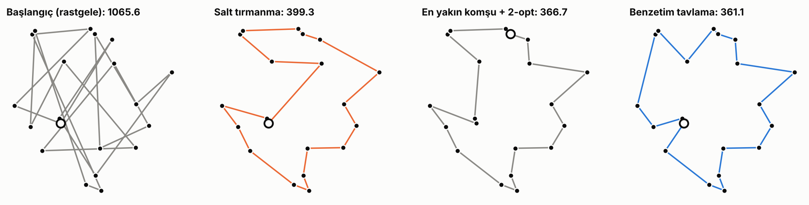
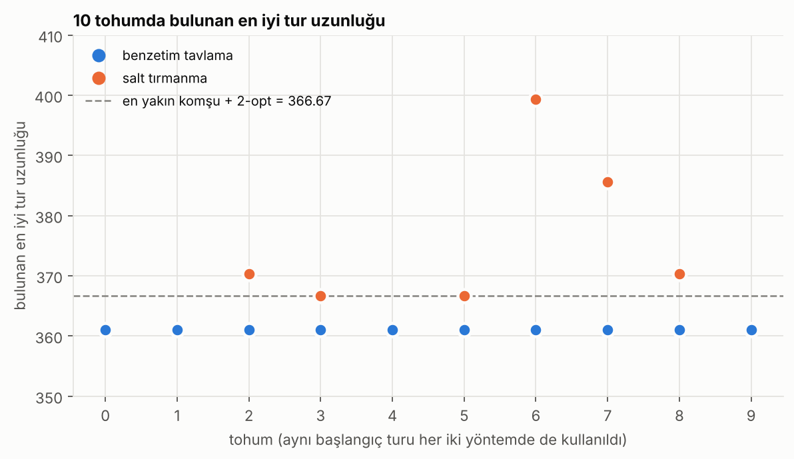

# Simulated Annealing for the Traveling Salesman Problem

[Türkçe](README.md) | English

A step-by-step hand calculation of simulated annealing, the Python code that reproduces it, and a general NumPy implementation on 20 cities.

All numbers and figures in this folder are generated from the code's output.

> Note: identifiers and comments in the code are in Turkish (e.g. `benzetim_tavlama` = simulated annealing, `sehirler_uret` = generate cities, `tohum` = seed, `kotulesme_kabul` = accept worse moves).

## What is simulated annealing?

Simulated annealing is a search method inspired by annealing in metallurgy, where a metal is cooled slowly into a stable structure. The idea:

- At each step, a small change to the current solution (a **neighbour**) is tried.
- If the neighbour is better, it is **always accepted**.
- If the neighbour is worse, it is **still accepted with some probability**. That probability depends on the temperature: large when hot, small when cold.
- The temperature is lowered slowly. Early on the algorithm explores a lot (it can escape local optima); at the end it almost only accepts improvements.

**Acceptance rule.** Let L be the length of the current solution, L' that of the candidate, and Δ = L' − L.

- If Δ ≤ 0, the candidate is accepted.
- If Δ > 0, compute P = exp(−Δ / T) and draw a random u in [0,1). **If u < P, accept**, otherwise reject.

**Cooling (geometric).** T(k+1) = α · T(k)

**Steps**

1. Choose a starting tour and an initial temperature T₀.
2. Generate a neighbouring tour from the current one.
3. Compute Δ and decide accept/reject with the rule above.
4. Update the best tour found so far.
5. T ← α · T.
6. Go back to step 2 until a stopping condition (iteration count or T very small) is met.

## 1. Hand calculation: 5-city TSP

File: [`sa_el_hesabi.py`](sa_el_hesabi.py)

### Problem

Cities A, B, C, D, E. Symmetric distance matrix:

| | A | B | C | D | E |
|---|---|---|---|---|---|
| **A** | 0 | 3 | 8 | 9 | 6 |
| **B** | 3 | 0 | 4 | 7 | 9 |
| **C** | 8 | 4 | 0 | 5 | 8 |
| **D** | 9 | 7 | 5 | 0 | 3 |
| **E** | 6 | 9 | 8 | 3 | 0 |

- Starting tour: `A-C-E-B-D-A`, d(A,C)=8 + d(C,E)=8 + d(E,B)=9 + d(B,D)=7 + d(D,A)=9 = **41**
- T₀ = 10, α = 0.8, 12 iterations in total
- Neighbour: swap two cities in the tour. City A stays fixed at position 0; the swapped positions are between 1 and 4.
- The random numbers are **fixed in advance** so the calculation can be followed by hand (which two positions are swapped and the u values for the acceptance test are listed at the top of the code).
- Since the number of cities is small, the **true optimum** was found by trying every tour: L = 21 (`A-B-C-D-E-A`).

### Detailed example iterations

#### Iteration 1 (T = 10.0000)

- Current tour: `A-C-E-B-D-A`, L = 41
- Neighbour: the cities at positions 1 and 3 (C and B) are swapped → `A-B-E-C-D-A`
- Candidate length: d(A,B)=3 + d(B,E)=9 + d(E,C)=8 + d(C,D)=5 + d(D,A)=9 = **34**
- Δ = 34 − 41 = **−7**
- Δ ≤ 0, so the candidate is **accepted** directly.

#### Iteration 3 (T = 6.4000)

- Current tour: `A-B-D-C-E-A`, L = 29
- Neighbour: the cities at positions 1 and 2 (B and D) are swapped → `A-D-B-C-E-A`
- Candidate length: d(A,D)=9 + d(D,B)=7 + d(B,C)=4 + d(C,E)=8 + d(E,A)=6 = **34**
- Δ = 34 − 29 = **+5**
- Δ > 0, so the probability is computed: P = exp(−5 / 6.4000) = **0.4578**
- Fixed random number u = 0.80. Since u ≥ P, the candidate is **rejected** and the tour stays the same.

#### Iteration 6 (T = 3.2768)

- Current tour: `A-C-D-E-B-A`, L = 28
- Neighbour: the cities at positions 2 and 3 (D and E) are swapped → `A-C-E-D-B-A`
- Candidate length: d(A,C)=8 + d(C,E)=8 + d(E,D)=3 + d(D,B)=7 + d(B,A)=3 = **29**
- Δ = 29 − 28 = **+1**
- Δ > 0, so the probability is computed: P = exp(−1 / 3.2768) = **0.7370**
- Fixed random number u = 0.30. Since u < P, the candidate is **accepted** even though it is worse.

#### Iteration 8 (T = 2.0972)

- Current tour: `A-D-E-C-B-A`, L = 27
- Neighbour: the cities at positions 2 and 4 (E and B) are swapped → `A-D-B-C-E-A`
- Candidate length: d(A,D)=9 + d(D,B)=7 + d(B,C)=4 + d(C,E)=8 + d(E,A)=6 = **34**
- Δ = 34 − 27 = **+7**
- Δ > 0, so the probability is computed: P = exp(−7 / 2.0972) = **0.0355**
- Fixed random number u = 0.22. Since u ≥ P, the candidate is **rejected** and the tour stays the same.


### All iterations

| k | T | current tour (L) | swap | candidate (L) | Δ | P = exp(−Δ/T) | u | decision | new L |
|---|---|---|---|---|---|---|---|---|---|
| 1 | 10.0000 | A-C-E-B-D-A (41) | 1↔3 | A-B-E-C-D-A (34) | −7 | 1 (Δ ≤ 0) | – | accept | 34 |
| 2 | 8.0000 | A-B-E-C-D-A (34) | 2↔4 | A-B-D-C-E-A (29) | −5 | 1 (Δ ≤ 0) | – | accept | 29 |
| 3 | 6.4000 | A-B-D-C-E-A (29) | 1↔2 | A-D-B-C-E-A (34) | +5 | 0.4578 | 0.80 | reject (u ≥ P) | 29 |
| 4 | 5.1200 | A-B-D-C-E-A (29) | 3↔4 | A-B-D-E-C-A (29) | 0 | 1 (Δ ≤ 0) | – | accept | 29 |
| 5 | 4.0960 | A-B-D-E-C-A (29) | 1↔4 | A-C-D-E-B-A (28) | −1 | 1 (Δ ≤ 0) | – | accept | 28 |
| 6 | 3.2768 | A-C-D-E-B-A (28) | 2↔3 | A-C-E-D-B-A (29) | +1 | 0.7370 | 0.30 | accept (u < P) | 29 |
| 7 | 2.6214 | A-C-E-D-B-A (29) | 1↔3 | A-D-E-C-B-A (27) | −2 | 1 (Δ ≤ 0) | – | accept | 27 |
| 8 | 2.0972 | A-D-E-C-B-A (27) | 2↔4 | A-D-B-C-E-A (34) | +7 | 0.0355 | 0.22 | reject (u ≥ P) | 27 |
| 9 | 1.6777 | A-D-E-C-B-A (27) | 1↔2 | A-E-D-C-B-A (21) | −6 | 1 (Δ ≤ 0) | – | accept | 21 |
| 10 | 1.3422 | A-E-D-C-B-A (21) | 3↔4 | A-E-D-B-C-A (28) | +7 | 0.0054 | 0.12 | reject (u ≥ P) | 21 |
| 11 | 1.0737 | A-E-D-C-B-A (21) | 1↔4 | A-B-D-C-E-A (29) | +8 | 0.0006 | 0.70 | reject (u ≥ P) | 21 |
| 12 | 0.8590 | A-E-D-C-B-A (21) | 2↔3 | A-E-C-D-B-A (29) | +8 | 0.0001 | 0.05 | reject (u ≥ P) | 21 |

### Result

- Best tour after 12 iterations: `A-E-D-C-B-A`, L = **21**
- The true optimum is 21. This tour is the optimum tour `A-B-C-D-E-A` traversed in the opposite direction, so its length is the same.
- In iteration 6 a worse candidate (Δ > 0) was accepted by chance. Rejected worse moves: iterations 3, 8, 10, 11, 12.
- The best value (21) was found in iteration 9.



> Note: in this example the fixed numbers led to the optimum in 9 iterations. In a real run the random numbers differ, so the path differs. That is why the general behaviour of the algorithm was measured with several seeds in the 20-city test below.

> Rounding: the probabilities shown are rounded to 4 decimals; the calculation itself uses full precision. If you round by hand as you go, the last digits may differ slightly.

## 2. General implementation: 20-city TSP

File: [`sa.py`](sa.py)

- Cities are generated randomly in a 100×100 square (`sehirler_uret(20, tohum=1)`).
- Neighbour: a **2-opt move** (reversing a segment of the tour). Δ is computed in O(1) from the 2 edges that change.
- T₀ = 100, α = 0.995, 100 neighbours tried at each temperature, stops when T < 0.001.
- Baselines: random tour, nearest neighbour, nearest neighbour + 2-opt local search, and **hill climbing** (the same code, but with acceptance of worse moves turned off).

### Results (one city instance, 10 seeds)

| method | tour length |
|---|---|
| random tour | 1104.76 |
| nearest neighbour | 445.79 |
| nearest neighbour + 2-opt | 366.67 |
| SA, mean over 10 seeds | 361.07 |
| SA, best / worst | 361.07 / 361.07 |
| hill climbing, mean over 10 seeds | 370.34 |
| hill climbing, best / worst | 361.07 / 399.32 |

For each seed, SA and hill climbing start from the **same random tour**:

| seed | 0 | 1 | 2 | 3 | 4 | 5 | 6 | 7 | 8 | 9 |
|---|---|---|---|---|---|---|---|---|---|---|
| SA | 361.07 | 361.07 | 361.07 | 361.07 | 361.07 | 361.07 | 361.07 | 361.07 | 361.07 | 361.07 |
| hill climbing | 361.07 | 361.07 | 370.40 | 366.67 | 361.07 | 366.67 | 399.32 | 385.62 | 370.40 | 361.07 |

- SA reached the same value in all 10 seeds (361.07), shorter than what nearest neighbour + 2-opt found.
- Hill climbing reached the same value in 4 of 10 seeds and got stuck in a local optimum in the others (worst: 399.32).
- I did **not prove** that 361.07 is the true optimum. It is only the best among the methods tried on this single city instance.

### Figures

The first three figures below (acceptance rate, convergence, tours) use seed 6: random starting tour 1065.59, SA final 361.07, hill climbing 399.32.



Left: for the same Δ, the probability of accepting a worse move drops quickly as the temperature falls. Right: in the actual run, the fraction of accepted moves falls with the temperature.



SA's current tour fluctuates early on because it accepts worse moves, and settles as it cools. Hill climbing drops very fast but stays in the first local optimum it finds.





*Figure labels are in Turkish: "salt tırmanma" = hill climbing, "benzetim tavlama" = simulated annealing, "en yakın komşu" = nearest neighbour, "tohum" = seed, "iterasyon" = iteration.*

## Effect of the parameters

- **T₀ (initial temperature):** If too low, the algorithm behaves like hill climbing from the start. If too high, the first part is wasted (random wandering).
- **α (cooling rate):** Closer to 1 means slower cooling, which gives better results but takes longer.
- **Steps per temperature:** Determines how much of the solution space is explored before the temperature changes.

The tests in this repository did **not** compare different values of these parameters; the notes above describe the general logic of the algorithm.

## Running

```bash
pip install -r requirements.txt

python sa_el_hesabi.py     # step-by-step output of the 5-city hand calculation
python sa.py               # 20-city test (about 30 seconds)
python gorseller_uret.py   # regenerates the gorseller/ folder (about 35 seconds)
```

## Files

| file | contents |
|---|---|
| `sa_el_hesabi.py` | step-by-step calculation for the 5-city TSP with fixed random numbers |
| `sa.py` | general SA, baseline methods and test |
| `gorseller_uret.py` | generates the figures used in the README |
| `gorseller/` | PNG figures |
